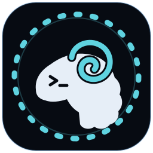
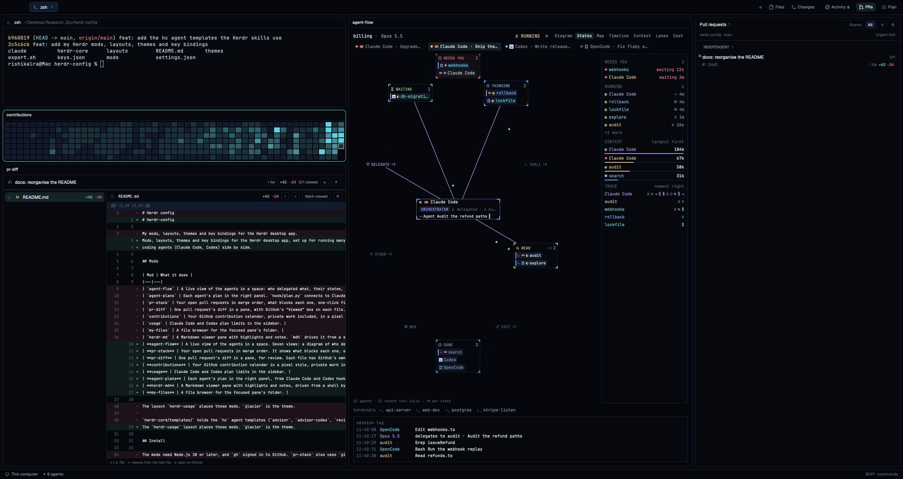
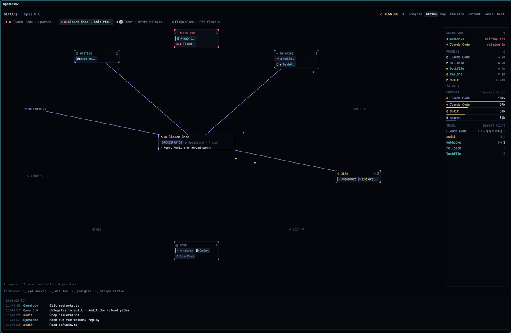
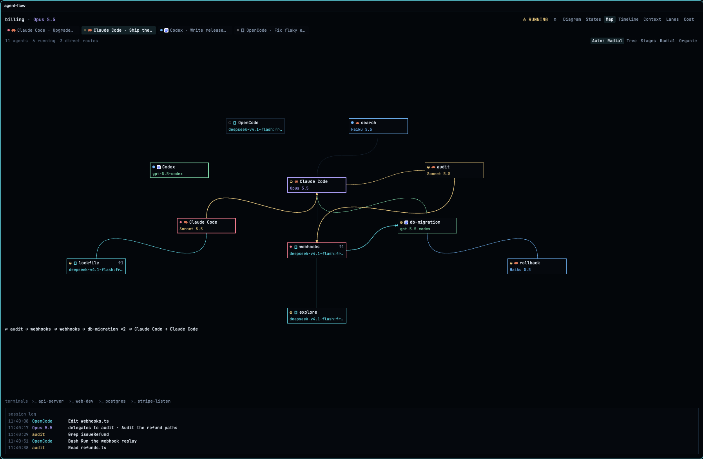
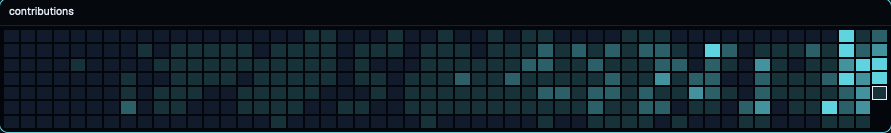

<p align="center">
  
</p>

<h1 align="center">corral</h1>

<p align="center">
  A <a href="#what-is-herdr">Herdr</a> setup for running a herd of coding agents side by side.<br>
  See what every agent is doing, review its pull requests, and keep an eye on your plan limits.
</p>

<p align="center">
  
  
  
  
</p>

<p align="center">
  <a href="#mods">Mods</a> ·
  <a href="#quick-start">Quick start</a> ·
  <a href="#screenshots">Screenshots</a> ·
  <a href="#related">Related</a>
</p>

[](docs/demo.mp4)

<p align="center"><sub>A Claude Code session and a Codex session make small changes to an example repo, while the
walkthrough steps through each mod. <a href="docs/demo.mp4">Watch it as an MP4</a>.</sub></p>

## What is Herdr

Herdr is a desktop app for running coding agents in terminals that stay alive. Its UI is built
from mods: small JavaScript views that you can change or replace. corral is my set of those mods,
with a layout, a theme and key bindings that tie them together.

## Mods

### Agents

| Mod | What it does |
|---|---|
| **agent-flow** | A live view of the agents in a space, in seven views: a diagram of who delegated what, agent states, a map, a timeline, context size, lanes and cost. It flags agents that look stuck and cache misses that cost money. |
| **agent-plans** | Each agent's plan in the right panel, from Claude Code and Codex hooks. |
| **usage** | Claude Code and Codex plan limits in the sidebar, with Codex's banked resets. |

### Pull requests

| Mod | What it does |
|---|---|
| **pr-stack** | Your open pull requests in merge order. It shows what blocks each one and offers one-click fixes. It can start agents that resolve conflicts or fix CI, and merge a whole stack. Each PR shows its merge risk and how long it has waited for review, and "Risk first" groups PRs by risk with the ones to review at the top. When a check on the trunk fails, an agent can find the cause or revert the commit. |
| **pr-diff** | One pull request's diff in a pane. Each file has GitHub's own "Viewed" box, so your review progress shows on GitHub too. Open it from the file counts on a pr-stack row. |

### Automation

| Mod | What it does |
|---|---|
| **schedules** | Runs agents on a schedule: hourly, daily or weekly, in a repo. Presets for the flaky-test check and verification upkeep. A run missed while the app was closed starts when it opens. |

### Workspace

| Mod | What it does |
|---|---|
| **contributions** | Your GitHub contribution calendar in a pixel style, private work included. In a short pane it shows only the squares. |
| **herdr-md** | A Markdown viewer pane with highlights and notes, driven from a shell by `mdh`. |
| **my-files** | A file browser for the focused pane's folder. |
| **walkthrough** | Plays a timeline of window commands with captions, for recording a demo like the one above. |

The `herdr-usage` layout places the mods, and `glacier` is the theme.

## Quick start

You need Herdr, Node.js 18 or later, and `gh` signed in to GitHub. pr-stack also uses `git` and
`hc`.

```sh
git clone https://github.com/rk68/corral.git && cd corral
rsync -a mods/    ~/.config/herdr-app/mods/
rsync -a layouts/ ~/.config/herdr-app/layouts/
rsync -a themes/  ~/.config/herdr-app/themes/
```

Then press `cmd-shift-l` in Herdr and choose the `herdr-usage` layout.

### Optional steps

- **Key bindings and settings.** Merge `keys.json` and `settings.json` into your own by hand.
  Copying them replaces your bindings.
- **Agent templates.** The Herdr skills in [rstack](https://github.com/rk68/rstack) start
  agents from these templates:

  ```sh
  mkdir -p ~/.config/herdr-core/templates
  cp herdr-core/templates/*.md ~/.config/herdr-core/templates/
  ```

- **Claude Code usage.** Copy `claude/statusline-usage.sh` to `~/.claude/` and set it as the
  Claude Code status line in `~/.claude/settings.json`:

  ```json
  { "statusLine": { "type": "command", "command": "~/.claude/statusline-usage.sh" } }
  ```

- **Merge risk in pr-stack.** Install [rstack](https://github.com/rk68/rstack). pr-stack scores PRs with its
  `merge-risk` skill, so the panel and your agents use the same rules. Without it, pr-stack hides the risk.
- **Math and diagrams in herdr-md.** Run `npm install` in `mods/herdr-md/render`.

contributions uses the pixel fonts of Herdr's built-in `win98` mod.

## Screenshots



### Agent Flow

The States view: each agent sits at the state it is in, and dots run along the lines while it works.



| Map | Timeline |
|---|---|
|  |  |

### PR diff


### Contributions and usage

| Contribution calendar in a short pane | Plan usage in the sidebar |
|---|---|
|  |  |

## Repository layout

```
mods/                   the mods
layouts/, themes/       the layout and themes
keys.json, settings.json
herdr-core/templates/   hc agent templates: advisor, advisor-codex, reviewer
claude/                 the Claude Code status line script that feeds the usage mod
docs/                   the logo, screenshots and demo video
export.sh               copies a live config from ~/.config/herdr-app into this folder
```

## Keep it up to date

`./export.sh` copies the live config into this folder. It skips app state, built-in mods,
`node_modules` and caches. Read `git diff` before you commit, because a mod can pick up private
names or paths.

## Related

- [rstack](https://github.com/rk68/rstack): the agent skills that go with corral, including
  skills that drive Herdr.

## Licence

MIT. See [LICENSE](LICENSE). `mods/herdr-md/marked.js` is under its own MIT licence, in
`mods/herdr-md/marked.LICENSE.md`.
