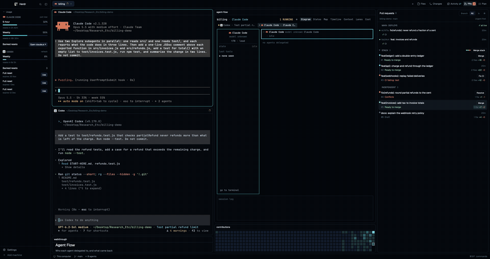
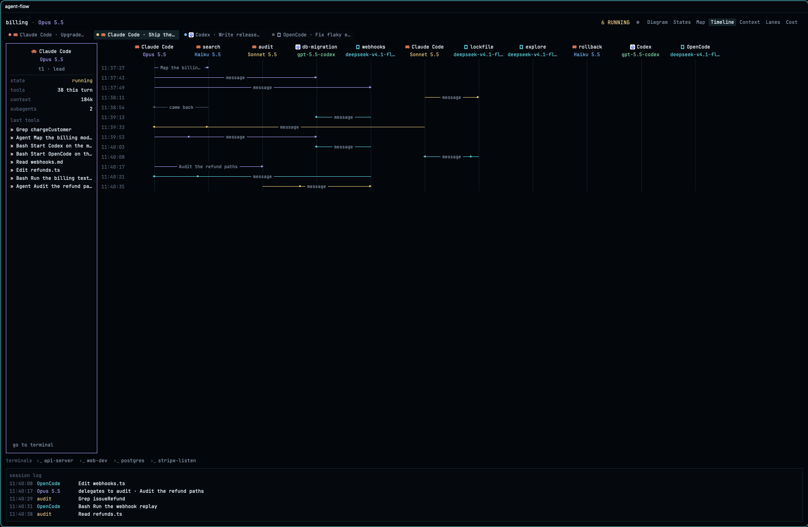
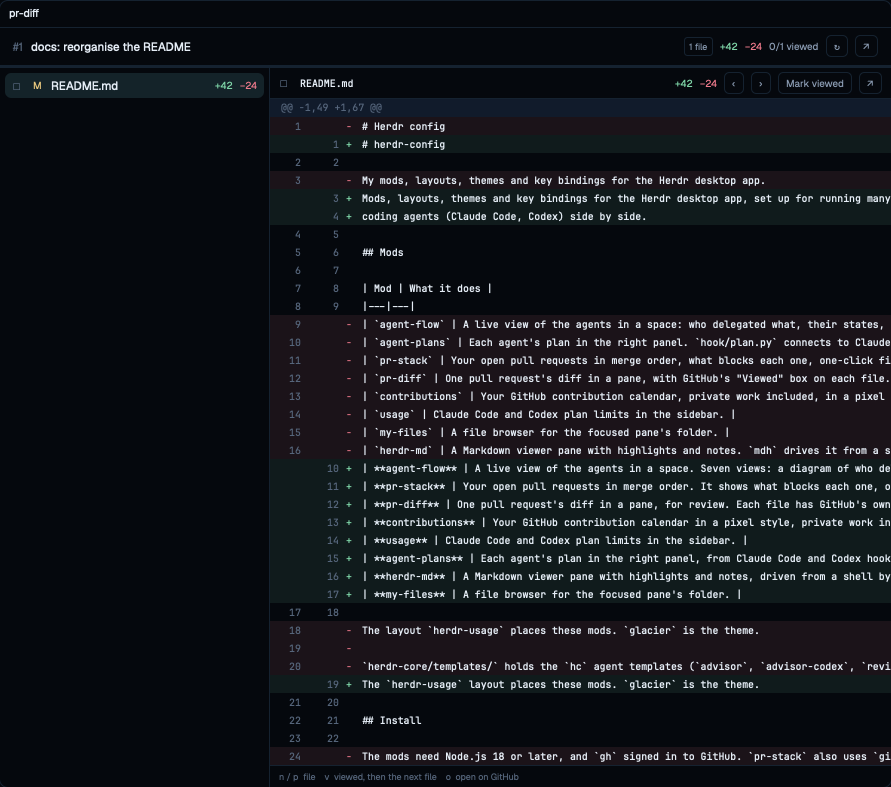
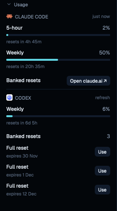

# herdr-config

Mods, layouts, themes and key bindings for the Herdr desktop app, set up for running many
coding agents (Claude Code, Codex) side by side.



<sub>A 30-second walkthrough: Agent Flow's views, PR Stack, PR Diff, Activity, Plan, the Markdown
viewer, Files and Usage. [Watch it as an MP4](docs/demo.mp4). The agents are Agent Flow's
built-in example data, and the pull requests are in a small example repo.</sub>

## Mods

| Mod | What it does |
|---|---|
| **agent-flow** | A live view of the agents in a space. Seven views: a diagram of who delegated what, agent states, a map, a timeline, context size, lanes and cost. It also flags stuck agents and cache misses. |
| **pr-stack** | Your open pull requests in merge order. It shows what blocks each one, offers one-click fixes, starts agents that resolve conflicts or fix CI, merges a whole stack, and shows the CI and deploy status of the trunk. |
| **pr-diff** | One pull request's diff in a pane, for review. Each file has GitHub's own "Viewed" box. Open it from the file counts on a pr-stack row. |
| **contributions** | Your GitHub contribution calendar in a pixel style, private work included. In a short pane it shows only the squares. |
| **usage** | Claude Code and Codex plan limits in the sidebar. |
| **agent-plans** | Each agent's plan in the right panel, from Claude Code and Codex hooks. |
| **herdr-md** | A Markdown viewer pane with highlights and notes, driven from a shell by `mdh`. |
| **my-files** | A file browser for the focused pane's folder. |
| **walkthrough** | Plays a timeline of window commands with captions, for recording a demo like the one above. |

The `herdr-usage` layout places these mods. `glacier` is the theme.

## Screenshots


### Agent Flow

The States view: each agent sits at the state it is in, and dots run along the lines while it works.


| Map | Timeline |
|---|---|
|  |  |

### PR diff

Click the file counts on a pr-stack row to review that pull request in a pane. Ticks in the
"Viewed" boxes show on GitHub too.



### Contributions and usage

| Contribution calendar in a short pane | Plan usage in the sidebar |
|---|---|
|  |  |

## Install

You need Node.js 18 or later, and `gh` signed in to GitHub. pr-stack also uses `git` and `hc`.

1. Copy the mods, layouts and themes into the app's config folder:

   ```sh
   rsync -a mods/    ~/.config/herdr-app/mods/
   rsync -a layouts/ ~/.config/herdr-app/layouts/
   rsync -a themes/  ~/.config/herdr-app/themes/
   ```

2. Merge `keys.json` and `settings.json` into your own by hand. Copying them replaces your bindings.
3. Copy the agent templates that the Herdr skills in [rk68/skill-suite](https://github.com/rk68/skill-suite) start:

   ```sh
   mkdir -p ~/.config/herdr-core/templates
   cp herdr-core/templates/*.md ~/.config/herdr-core/templates/
   ```

4. For the usage mod, copy `claude/statusline-usage.sh` to `~/.claude/` and set it as the Claude Code status line in `~/.claude/settings.json`:

   ```json
   { "statusLine": { "type": "command", "command": "~/.claude/statusline-usage.sh" } }
   ```

5. For math and diagrams in herdr-md, run `npm install` in `mods/herdr-md/render`.
6. Press `cmd-shift-l` and choose the `herdr-usage` layout.

contributions uses the pixel fonts of the app's built-in `win98` mod.

## Repository layout

```
docs/                   screenshots
mods/                   the mods
layouts/, themes/       layouts and themes
keys.json, settings.json
herdr-core/templates/   hc agent templates: advisor, advisor-codex, reviewer
claude/                 the Claude Code status line script that feeds the usage mod
export.sh               copies the live config from ~/.config/herdr-app into this folder
```

## Update this repo

`./export.sh` copies the live config into this folder. It skips app state, built-in mods,
`node_modules` and caches. Read `git diff` before you commit, because a mod can pick up private
names or paths.
